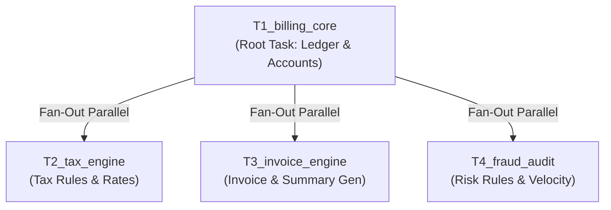

# BRD-002: Enterprise Billing & Transaction Audit Core

**Document ID:** BRD-NEXORA-002  
**Project:** NEXORA Software Factory  
**Target Module:** `billing/`  
**Status:** Approved for Orchestration  
**Architecture Style:** Modular Monolith (Fintech Core)  
**Execution Topology:** 1 Root Task + 3 Concurrent Parallel Worker Nodes (Fan-Out)  

---

## 1. Executive Summary & Objective
Build an enterprise-grade, in-memory **Billing & Transaction Processing Core** inside the `billing/` directory. This module serves as a production-grade acceptance workload to test the **Parallel Concurrency and Fan-Out capabilities** of the NEXORA Deterministic Go DAG Orchestrator.

The module implements a double-entry ledger domain, followed by three distinct, decoupled engines (Tax Calculation, Invoice Formatting, and Fraud Auditing) executing simultaneously across parallel isolated Git worktrees.

---

## 2. Technical Scope & Architecture Invariants

- **Ecosystem:** Vanilla ECMAScript (ES2022+), Node.js native test runner (`node --test`), zero external NPM packages.
- **Concurrency Invariant:** Tasks T2, T3, and T4 have zero cross-dependencies on each other. All three must execute **concurrently in parallel** as soon as Task T1 completes.
- **Directory Layout:**
  ```text
  billing/
  ├── ledger.js              # Double-entry ledger core (Accounts, Debits, Credits)
  ├── tax.js                 # Multi-region tax rules (US Sales Tax, EU VAT, Zero-rated)
  ├── invoice.js             # Structured billing invoice & statement generator
  ├── fraud.js               # Velocity rules, high-value alerts, risk scoring
  └── test/
      ├── ledger.test.js     # Tests for T1
      ├── tax.test.js        # Tests for T2
      ├── invoice.test.js    # Tests for T3
      └── fraud.test.js      # Tests for T4
  ```

---

## 3. Functional Requirements

### 3.1 Task 1: Double-Entry Ledger Core (`billing/ledger.js`)
- **Entities:**
  - `Account`: `{ id, name, type: 'ASSET' | 'LIABILITY' | 'EQUITY' | 'REVENUE' | 'EXPENSE', balance }`
  - `Transaction`: `{ id, date, description, entries: [{ accountId, amount, type: 'DEBIT' | 'CREDIT' }] }`
- **Invariants:**
  - Double-Entry Rule: Total Debits must exactly equal Total Credits for every transaction.
  - Accounts must update balances atomically.
- **Test Gate:** `node --test billing/test/ledger.test.js`

---

### 3.2 Task 2: Multi-Region Tax Engine (`billing/tax.js`) [Parallel Worker A]
- **Depends on:** `T1_billing_core`
- **Capabilities:**
  - Calculates line-item tax rates based on customer jurisdiction:
    - `US`: State sales tax lookup (e.g. CA 7.25%, NY 4.00%).
    - `EU`: Standard VAT rate (e.g. DE 19%, FR 20%) with B2B reverse-charge exemption.
    - `EXEMPT`: Zero-rate (0%).
  - Returns `{ subtotal, taxAmount, total, rateApplied, jurisdiction }`.
- **Test Gate:** `node --test billing/test/tax.test.js`

---

### 3.3 Task 3: Invoice Generation Engine (`billing/invoice.js`) [Parallel Worker B]
- **Depends on:** `T1_billing_core`
- **Capabilities:**
  - Consumes ledger transactions and produces immutable, finalized invoice objects:
    - `{ invoiceNumber, customerId, issueDate, dueDate, lineItems, subtotal, tax, total, status: 'ISSUED' }`.
    - Human-readable text statement generation: `generateTextSummary(invoice)`.
- **Test Gate:** `node --test billing/test/invoice.test.js`

---

### 3.4 Task 4: Fraud & Risk Scoring Engine (`billing/fraud.js`) [Parallel Worker C]
- **Depends on:** `T1_billing_core`
- **Capabilities:**
  - Evaluates transactions against enterprise risk rules:
    - **Velocity Check**: More than 3 transactions on the same account within 60 seconds triggers `WARNING`.
    - **High-Value Threshold**: Transactions exceeding \$10,000 require `MANUAL_REVIEW`.
    - **Risk Score**: Returns a score from 0 to 100 with flagged rule violations.
- **Test Gate:** `node --test billing/test/fraud.test.js`

---

## 4. DAG Specification (Topological Fan-Out)



```json
{
  "tasks": [
    {
      "id": "T1_billing_core",
      "name": "Fintech double-entry ledger domain and tests",
      "dependencies": [],
      "worktree_branch": "task/t1-billing-core",
      "verify_command": "node --test billing/test/ledger.test.js"
    },
    {
      "id": "T2_tax_engine",
      "name": "Multi-region sales tax and VAT calculation engine",
      "dependencies": ["T1_billing_core"],
      "worktree_branch": "task/t2-tax-engine",
      "verify_command": "node --test billing/test/tax.test.js"
    },
    {
      "id": "T3_invoice_engine",
      "name": "Invoice and billing statement generation engine",
      "dependencies": ["T1_billing_core"],
      "worktree_branch": "task/t3-invoice-engine",
      "verify_command": "node --test billing/test/invoice.test.js"
    },
    {
      "id": "T4_fraud_audit",
      "name": "Transaction fraud velocity and risk auditing rules",
      "dependencies": ["T1_billing_core"],
      "worktree_branch": "task/t4-fraud-audit",
      "verify_command": "node --test billing/test/fraud.test.js"
    }
  ]
}
```
