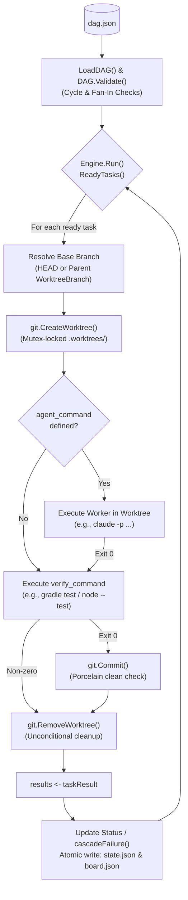

# NEXORA Deterministic DAG Engine

A compiled Go (`1.23.4`) **Macro-Orchestrator** for the NEXORA Software Factory.

Instead of relying on an LLM prompt to track state and coordinate workflows, this engine acts as a deterministic control plane: it validates a Directed Acyclic Graph (`dag.json`), provisions isolated Git worktrees per task, dispatches optional autonomous worker commands (`agent_command`), enforces binary compiler/test quality gates (`verify_command`), commits verified changes onto inherited branches, and streams progress atomically to the factory dashboard.

---

## What the Engine Is Capable Of So Far

### 1. Deterministic Graph Validation (`pkg/dag`)
- **Schema Compilation:** Loads `dag.json` task lists into typed [`TaskNode`](pkg/dag/types.go#L20-L28) structs (`id`, `name`, `dependencies`, `worktree_branch`, `agent_command`, `verify_command`).
- **Unknown Dependency Checks:** Rejects graphs referencing nonexistent task IDs before executing any command.
- **Cycle Detection:** Runs a 3-color (White/Gray/Black) depth-first search (`detectCycles`) to fail fast on circular dependencies.
- **Topological Utilities:** Exposes `TopologicalOrder()`, `ReadyTasks()`, and `AllTerminal()`.
- **Multi-Parent Fan-In Guard:** Explicitly rejects tasks with `len(Dependencies) > 1` in `Validate()` to prevent silent dependency loss until an automated Git merge station is implemented.

### 2. Concurrent Execution & Parallel Fan-Out (`pkg/runner`)
- **Event-Driven Goroutine Pool:** Dispatches every task whose dependencies are all `COMPLETED` concurrently using Go goroutines, collecting completion events over a `chan taskResult`.
- **Parallel Root & Fan-Out Topologies:** Executes independent root tasks or `1 -> N` fan-out branches simultaneously (proven on polyglot workloads running Java/Gradle and React/Node tests in parallel).
- **Cascading Failure Propagation:** If an upstream prerequisite fails, `cascadeFailure()` marks all transitive `PENDING` dependents as `FAILED` so the run loop exits cleanly rather than deadlocking.

### 3. Isolated Git Worktrees & Branch Inheritance (`pkg/git`)
- **Per-Task Worktree Isolation:** Spawns a dedicated directory at `.worktrees/<taskID>` via `git worktree add`, eliminating cross-agent file collisions.
- **Branch Inheritance:**
  - Root tasks (`dependencies: []`) branch off `HEAD`.
  - Dependent tasks branch off their prerequisite dependency's `WorktreeBranch`, automatically inheriting all committed files and tests.
- **Retry-Safe Branch Reset (`-B`):** Uses `git worktree add ... -B <targetBranch> <baseBranch>` so re-running or retrying a task resets any leftover branch instead of failing.
- **Thread-Safe Git Metadata Locking:** Serializes root-repository worktree creation and removal with a `sync.Mutex` (`WorktreeManager.mu`) to prevent `.git/index.lock` contention during parallel fan-out, while leaving in-worktree execution and commits unconstrained.
- **Empty-Commit Guard:** `Commit()` stages changes (`git add -A`) and checks `git status --porcelain` before committing, making read-only verification tasks safe no-ops rather than failing on Git's exit code `1`.
- **Unconditional Teardown:** Removes `.worktrees/<taskID>` after execution on both success and failure (preserving the original verification/commit error if one occurred) so stale directories do not accumulate.

### 4. Autonomous Worker Dispatch & Binary Verification (`pkg/runner/exec.go`)
- **Pluggable Worker Workstation (`agent_command`):** Optionally executes an autonomous coding command (such as non-interactive `claude -p "..." --dangerously-skip-permissions` or a custom worker script) inside the task's worktree before verification.
- **Exit-Code Quality Gate (`verify_command`):** Runs the verification command inside the worktree via `sh -c`. Code is committed and marked `COMPLETED` **only** when the exit code is `0`.

### 5. Atomic State Persistence & Live Dashboard Bridge (`pkg/board`)
- **Crash-Safe State Writes:** Writes `state.json` and `board.json` via `os.CreateTemp` + `os.Rename` so `factory/dashboard.html`'s 2-second HTTP poll never reads partially written JSON.
- **Dashboard Stage Mapping:** Syncs task states onto the Kanban board columns:
  - `PENDING` / `READY` $\rightarrow$ `spec`
  - `RUNNING` $\rightarrow$ `build`
  - `COMPLETED` $\rightarrow$ `merged` (`code: PASS`)
  - `FAILED` $\rightarrow$ `needs-human` (`code: CHANGES`)

---

## Architecture & Execution Flow



### Package Layout

```text
factory/engine/
├── go.mod                 # Module nexora/engine (Go 1.23.4, zero external dependencies)
├── main.go                # CLI entrypoint (-dag, -state, -board, -repo flags)
└── pkg/
    ├── board/
    │   └── board.go       # Atomic board.json writer for factory/dashboard.html
    ├── dag/
    │   └── types.go       # TaskNode, TaskStatus, DAG validation & cycle detection
    ├── git/
    │   └── worktree.go    # Mutex-protected git worktree create/commit/remove wrappers
    └── runner/
        ├── exec.go        # Shell command executor inside a target directory
        ├── runner.go      # Event-driven DAG runner, branch inheritance, state persistence
        └── runner_test.go # Integration tests over real temporary git repositories
```

---

## Usage

### Prerequisites
- **Go** `1.23.4+`
- **Git** (`2.5+` with worktree support)
- Optional: **Python 3** (to serve `factory/dashboard.html` over HTTP)

### CLI Flags

Run from the repository root (resolved via [`go.work`](../../go.work)):

```bash
go run factory/engine/main.go -dag <path-to-dag.json> [options]
```

| Flag | Default | Description |
| :--- | :--- | :--- |
| `-dag` | *(required)* | Path to the `dag.json` task specification file |
| `-state` | `factory/state.json` | Path to the atomic task-status ledger |
| `-board` | `factory/board.json` | Path to the dashboard board JSON file |
| `-repo` | `.` | Repository root where `.worktrees/` are created |

### Example `dag.json`

```json
{
  "tasks": [
    {
      "id": "T1_core",
      "name": "Scaffold core module and unit tests",
      "dependencies": [],
      "worktree_branch": "task/t1-core",
      "agent_command": "claude -p \"Implement the core domain and tests.\" --dangerously-skip-permissions",
      "verify_command": "npm test"
    },
    {
      "id": "T2_adapter_a",
      "name": "Build Adapter A (inherits T1)",
      "dependencies": ["T1_core"],
      "worktree_branch": "task/t2-adapter-a",
      "agent_command": "claude -p \"Implement Adapter A.\" --dangerously-skip-permissions",
      "verify_command": "npm test"
    },
    {
      "id": "T3_adapter_b",
      "name": "Build Adapter B in parallel (inherits T1)",
      "dependencies": ["T1_core"],
      "worktree_branch": "task/t3-adapter-b",
      "agent_command": "claude -p \"Implement Adapter B.\" --dangerously-skip-permissions",
      "verify_command": "npm test"
    }
  ]
}
```

### Viewing the Live Dashboard

Serve `factory/` over HTTP so `dashboard.html` can poll `board.json`:

```bash
cd factory && python3 -m http.server 8000
```

Then open <http://localhost:8000/dashboard.html> and run the engine in another terminal.

---

## Testing

Run the integration test suite from `factory/engine/`:

```bash
cd factory/engine && go test -v ./...
```

The test suite in [`pkg/runner/runner_test.go`](pkg/runner/runner_test.go) exercises real Git repositories and verifies:
1. `TestEngine_TwoNodeDAG_BranchInheritance` — Proves `T2` inherits `T1`'s commit via `git merge-base --is-ancestor`, verifies commit count, and checks worktree cleanup.
2. `TestEngine_FailurePropagatesToDependents` — Proves upstream failures cascade to blocked downstream tasks.
3. `TestEngine_TaskWithNoChanges_Succeeds` — Proves read-only/no-op verification tasks pass without empty-commit failures.
4. `TestDAG_MultiDependency_ReturnsValidationError` — Proves `DAG.Validate()` rejects multi-parent fan-in until a merge station exists.
5. `TestEngine_WorktreeCleanedUpOnFailure` — Proves `.worktrees/<id>` is torn down even when a task fails.
6. `TestEngine_AgentCommand_ExecutesAndInherits` — Proves `agent_command` executes inside the worktree before `verify_command` and downstream tasks inherit the generated files.

---

## Current Limitations & Next Milestones

- **Multi-Parent Fan-In:** Tasks with more than one dependency are currently blocked at validation time until a Git integration/merge station is implemented.
- **No Error-Driven Micro-Retry Loop:** If `verify_command` fails, the task immediately marks `FAILED` rather than feeding `stderr` back into `agent_command` for automated retries.
- **External DAG Authoring:** `dag.json` must be supplied to the engine; automated BRD/PRD-to-DAG planning inside the Go binary is planned for the next stage.
- **Local Isolation Only:** Execution uses local Git worktrees rather than containerized/microVM sandboxes or distributed durable orchestration (Temporal).
